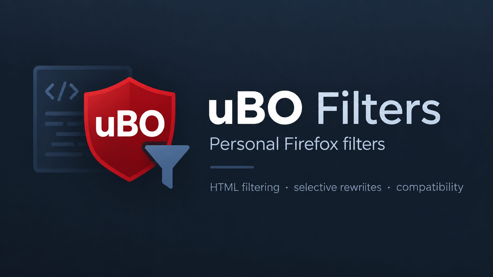

# uBO-Filters

This filter list is provided strictly AS IS, without any warranty, maintenance commitment, or obligation to provide technical support.

Personal uBlock Origin filters for Firefox only.
Published for personal synchronization and reference. Not intended for third-party use or public distribution.
List is used for experimental filters as well, not only tested ones. That can be enforced at any time.

No support or compatibility guarantees are provided. Use at your own risk.

# How These Filters Work

These filters target trackicng components at its execution points rather than relying solely on network blocking.

Using uBlock Origin's HTML filtering, they remove matching tracking, fingerprinting, and anti-adblock components before the browser parses them. Although ads are not the target of this list, they may also be removed when bundled with tracking components.

Importantly, HTML filtering does not prevent subsequent dynamic loading or execution through other code paths. This intentional limitation helps preserve website functionality.

Selective response rewriting, compatibility scriptlets, and carefully designed exclusions further minimize unintended breakage.

This is not a standalone filter list. Other standard uBlock Origin filter lists must remain enabled to handle subsequent network requests and residual tracking.

The objective is to prevent unwanted code from executing at its source while preserving legitimate website functionality.
